<!-- 👀 Reading the source? That's the kind of curiosity I like. Say hi: endset@outlook.com -->
<div align="center">



<br/>

[](https://www.linkedin.com/in/thechiragyadav/)
[](mailto:endset@outlook.com)
[](mailto:endset@outlook.com?subject=Let's%20work%20together)

<sub>🧠 AI/ML &nbsp;·&nbsp; 🧩 Full-stack &nbsp;·&nbsp; 📱 Apps &nbsp;·&nbsp; 🔭 Currently building <b>EchoCoder</b> & <b>Echo AI SDK</b></sub>

<br/>

<a href="https://github.com/endse"></a>&nbsp;<a href="https://github.com/endse?tab=followers"></a>

</div>

## `~/about-me`

```yaml
name: Chirag Yadav
roles: [AI/ML Engineer, Full-Stack Developer, App Developer]
focus:
  - Applied AI: LLM agents, tool use, RAG & knowledge graphs
  - Backend architecture: APIs, workflows, real-time systems
  - Cross-platform apps: Flutter, React, FastAPI, Node
open_to: [full-time roles, freelance, interesting collaborations]
superpower: Turning "what if?" into a working prototype
known_bug: One more refactor before I sleep  # wontfix
```

I like building systems that hold up outside the demo: useful AI, reliable backends and products that solve real problems. I'm comfortable going from a research idea to a shipped product.

> **The rule I work by:** make it work, understand *why* it works, then make it scale.

## `~/featured-projects` ⚡

<table>
<tr>
<td width="50%" valign="top">

### ⚖️ Nyayshakti
**Legal intelligence · AI**

A legal-tech platform that makes complex legal information easier to explore, using structured document intelligence, retrieval and connected legal knowledge.

[<kbd> Explore Nyayshakti ↗ </kbd>](https://github.com/Endsett/Nyayshakti)

</td>
<td width="50%" valign="top">

### 🧠 EchoMind
**AI product**

One of the core projects in my AI ecosystem. The repo covers the implementation, architecture and what it can do today.

[<kbd> Explore EchoMind ↗ </kbd>](https://github.com/endse/EchoMind)

</td>
</tr>
<tr>
<td width="50%" valign="top">

### 🪄 Echo AI SDK
**AI orchestration · TypeScript** &nbsp; [](https://www.npmjs.com/package/@endsett/echo-ai-sdk)

An all-in-one toolkit for building chat, voice, tool-using and agent-powered apps.

- Multi-provider model gateway with fallbacks
- Agent executors, tools and structured outputs
- RAG, persistent memory and semantic search
- Middleware, analytics and integrations

[<kbd> Explore Echo AI SDK ↗ </kbd>](https://github.com/Endsett/Echo-ai-sdk)

</td>
<td width="50%" valign="top">

### 🕸️ Hierarchical Legal Graph Chunking
**Legal RAG · Knowledge graphs**

Structure-aware legal document processing that keeps hierarchy, context and relationships instead of splitting a judgment into disconnected chunks.

- Hierarchical document structure
- Context-aware chunking
- Graph-oriented legal relationships
- Retrieval-ready legal knowledge

[<kbd> Explore HLGC ↗ </kbd>](https://github.com/Endsett/Hierarchical-Legal-Graph-Chunking)

</td>
</tr>
<tr>
<td width="50%" valign="top">

### 🥊 NeoSpartan
**AI fitness · Flutter + FastAPI**

An AI-powered combat-sports training platform with personalized training and workout optimization.

- Gemini-powered workout generation
- Flutter app + FastAPI backend
- Supabase data and authentication
- WebSocket updates and DOM-RL optimization

[<kbd> Explore NeoSpartan ↗ </kbd>](https://github.com/Endsett/Neospartan)

</td>
<td width="50%" valign="top">

### 👾 EchoCoder
**AI-native IDE · Developer tools**

An AI-native VS Code experience built around agentic coding workflows.

- Agent panel and native chat participant
- Ghost Text autocomplete and inline edits
- Multi-file Composer
- Plan → Approve → Execute → Verify
- Guardrails for tool use and sensitive paths

[<kbd> Explore EchoCoder ↗ </kbd>](https://github.com/Endsett/Echocoder)

</td>
</tr>
</table>

## `~/other-builds` 🧪

| Project | What's inside |
|---|---|
| [DOM-RL](https://github.com/endse/domrl) | Multi-objective deep RL for recommendation systems: hybrid SAC + NSGA-II |
| [FraudGuard AI](https://github.com/endse/Credit-card-fraud-analysis) | Explainable fraud detection with XGBoost, deterministic rules, FastAPI and React |
| [Sahara Agile Works](https://github.com/endse/Sahara-agile) | Full-stack project & employee operations with PostgreSQL and background jobs |
| [Realtime Chat](https://github.com/endse/realtime-chatapp) | Real-time messaging with React, Node.js, Express and Socket.IO |
| [OpenClaw](https://github.com/endse/openclaw) | AI and automation experiments |
| [Inven-Bot](https://github.com/endse/inven-bot) | Inventory and bot-oriented project work |

<details>
<summary><b>🗃️ More repositories & experiments</b></summary>
<br/>

[E-book Server](https://github.com/endse/ebook_server) ·
[Superchat](https://github.com/endse/superchat) ·
[WebSocket experiments](https://github.com/endse/Websocket) ·
[CodeAlpha E-commerce](https://github.com/endse/CodeAlpha_ecommweb)

</details>

## `~/tech-stack` 🧰

<div align="center">

**Languages**<br/>


**Backend, data & infra**<br/>


**Frontend, mobile & ML**<br/>


</div>

## `~/github-telemetry` 📡

<div align="center">

<a href="https://github.com/endse"></a>&nbsp;<a href="https://github.com/endse"></a>


<br/><br/>

<a href="https://github.com/endse"></a>

<sub>🐍 This snake actually grows: +1 to +4 segments per square, depending on how many commits I made that day. It's <a href="./scripts/generate_snake.py">custom-built</a> and regenerated every day.</sub>

</div>

## `~/currently-building` 🚧

- 🤖 Making AI agents more useful with better tools, memory and orchestration.
- ⚖️ Improving retrieval for legal documents and other knowledge-heavy workflows.
- 🛠️ Building backends that stay reliable when things go wrong, not just when they go right.
- 🚀 Turning big ideas into real products, one commit at a time.

<details>
<summary><b>🎲 Fun facts</b></summary>
<br/>

- My first instinct with any new problem is "can I make a CLI for that?"
- I measure a project's progress by how many diagrams I've drawn on paper.
- I named a project NeoSpartan and now I feel obligated to train like one.
- Favourite debugging tool: explaining the bug out loud until it fixes itself.

> *"First, solve the problem. Then, write the code."* — John Johnson

</details>

<details>
<summary><b>🥚 Don't click this</b></summary>
<br/>

```text
$ sudo make me-a-coffee
[sudo] password for chirag: ********
☕ Brewing... done. Productivity +10, sleep -2.

$ git blame life.js
chirag  "it worked on my machine"  (every Friday, 11:58 PM)
```

You clicked anyway. You're curious, and that's a good sign. [Let's talk](mailto:endset@outlook.com?subject=I%20found%20the%20easter%20egg%20🥚).

</details>

---

<div align="center">

### Got an interesting problem, role or idea?

**I'm open to full-time roles and freelance work in AI/ML, full-stack and app development.**<br/>
Let's build something useful together.

[](mailto:endset@outlook.com?subject=Opportunity%20for%20Chirag)
[](https://www.linkedin.com/in/thechiragyadav/)
[](https://github.com/endse)

<sub>Graphics on this page are generated by <a href="./scripts">scripts in this repo</a> and refreshed daily by GitHub Actions.</sub>

</div>
