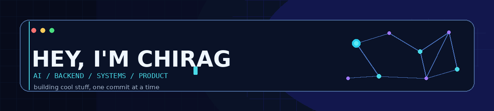
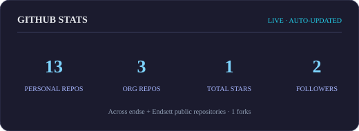
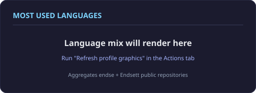
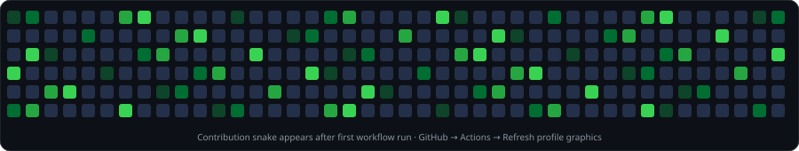

<div align="center">



[](https://github.com/endse)
[](https://github.com/endse?tab=followers)
[](https://github.com/endse?tab=repositories)

</div>

---

## `~/about-me`

```yaml
name: Chirag Yadav
role: Senior Developer
currently_into:
  - Applied AI & agent systems
  - Backend architecture & distributed workflows
  - RAG, knowledge graphs & retrieval
  - Building products people can actually use
superpower: Turning "what if?" into a working prototype
weakness: One more refactor before I sleep
```

I like building systems that do more than just look good in a demo. That means useful AI, reliable backends, thoughtful architecture, and products that solve real problems. I move between research-heavy ideas and hands-on product engineering.

**A little rule I follow:** make it work, understand why it works, then make it scale.

## `~/featured-projects` ⚡

These are the main projects I want you to see first. Pick one, open the repo, and go down the rabbit hole.

<table>
<tr>
<td width="50%" valign="top">

### ⚖️ Nyayshakti
**Legal intelligence / AI**

A legal-tech platform focused on making complex legal information easier to explore through structured document intelligence, retrieval and connected legal knowledge.

[<kbd> Explore Nyayshakti ↗ </kbd>](https://github.com/Endsett/Nyayshakti)

</td>
<td width="50%" valign="top">

### 🧠 EchoMind
**AI project / product**

One of the core projects in my AI ecosystem. Explore the repository for its implementation, architecture and current capabilities.

[<kbd> Explore EchoMind ↗ </kbd>](https://github.com/endse/EchoMind)

</td>
</tr>
<tr>
<td width="50%" valign="top">

### 🪄 Echo AI SDK
**AI orchestration / TypeScript**

An all-in-one toolkit for building chat, voice, tools and agent-powered applications.

- Multi-provider model gateway and fallbacks
- Agent executors, tools and structured outputs
- RAG, persistent memory and semantic search
- Middleware, analytics and integrations

[<kbd> Explore Echo AI SDK ↗ </kbd>](https://github.com/Endsett/Echo-ai-sdk)
[](https://www.npmjs.com/package/@endsett/echo-ai-sdk)

</td>
<td width="50%" valign="top">

### 🕸️ Hierarchical Legal Graph Chunking
**Legal RAG / Knowledge graphs**

A structure-aware approach to legal document processing: preserve hierarchy, context and relationships instead of flattening a judgment into disconnected text chunks.

- Hierarchical document structure
- Context-aware chunking
- Graph-oriented legal relationships
- Retrieval-ready legal knowledge

[<kbd> Explore HLGC ↗ </kbd>](https://github.com/Endsett/Hierarchical-Legal-Graph-Chunking)

</td>
</tr>
<tr>
<td width="50%" valign="top">

### 🥊 NeoSpartan
**AI fitness / Flutter + FastAPI**

An AI-powered combat-sports training platform that brings personalized training and workout optimization together.

- Gemini-powered workout generation
- Flutter app + FastAPI backend
- Supabase data and authentication
- WebSocket updates and DOM-RL optimization

[<kbd> Explore NeoSpartan ↗ </kbd>](https://github.com/Endsett/Neospartan)

</td>
<td width="50%" valign="top">

### 👾 EchoCoder
**AI-native IDE / Developer tools**

An AI-native VS Code experience built around agentic coding workflows.

- Agent panel and native chat participant
- Ghost Text autocomplete and inline edits
- Multi-file Composer
- Plan → Approve → Execute → Verify
- Guardrails for tool use and sensitive paths

[<kbd> Explore EchoCoder ↗ </kbd>](https://github.com/Endsett/Echocoder)

</td>
</tr>
</table>

## `~/other-builds` 🧪

| Project | What's inside |
|---|---|
| [DOM-RL](https://github.com/endse/domrl) | Multi-objective deep reinforcement learning for recommendation systems — Hybrid SAC + NSGA-II |
| [FraudGuard AI](https://github.com/endse/Credit-card-fraud-analysis) | Explainable fraud detection with XGBoost, deterministic rules, FastAPI and React |
| [Sahara Agile Works](https://github.com/endse/Sahara-agile) | Full-stack project and employee operations with PostgreSQL and background job patterns |
| [Realtime Chat](https://github.com/endse/realtime-chatapp) | Real-time messaging with React, Node.js, Express and Socket.IO |
| [OpenClaw](https://github.com/endse/openclaw) | AI and automation experiments |
| [Inven-Bot](https://github.com/endse/inven-bot) | Inventory and bot-oriented project work |

<details>
<summary><b>🗃️ More repositories & experiments</b></summary>
<br/>

[ E-book Server ](https://github.com/endse/ebook_server) ·
[ Superchat ](https://github.com/endse/superchat) ·
[ WebSocket experiments ](https://github.com/endse/Websocket) ·
[ CodeAlpha E-commerce ](https://github.com/endse/CodeAlpha_ecommweb)

</details>

## `~/tech-stack` 🧰

I like keeping the toolbox broad. These are the technologies I work with and explore.

<div align="center">

### Languages


### Backend, databases & infrastructure


### Frontend, mobile & machine learning


</div>

## `~/github-telemetry` 📡

<div align="center">

<a href="https://github.com/endse"></a>
<a href="https://github.com/endse"></a>

<br/>


<br/>

<a href="https://github.com/endse"></a>

<a href="https://github.com/endse">Open the native GitHub contribution graph ↗</a>

</div>

## `~/currently-building` 🚧

- Making AI agents more useful with tools, memory and solid orchestration.
- Exploring better retrieval for legal documents and knowledge-heavy workflows.
- Building backend systems that are reliable beyond the happy path.
- Turning ambitious ideas into real products, one commit at a time.

---

<div align="center">

### Got an interesting problem?

**Let's build something useful (and maybe break a few things along the way).**

[](https://github.com/endse)

</div>
