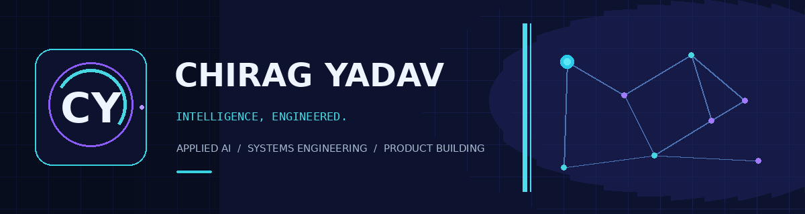

**Senior Developer · Applied AI · Systems Engineering**

*I build intelligent systems that turn complex information and workflows into useful, dependable software.*

[GitHub](https://github.com/endse) · [Projects](#02--selected-work) · [Engineering focus](#04--engineering-focus)

---

## 01 / THE POINT OF VIEW

I work where **AI engineering, knowledge systems, and backend architecture** meet.

My focus is not just making a model produce an answer. It is engineering the surrounding system: how information is structured, how context is retrieved, how agents use tools, how workflows recover from failure, and how the result becomes a product people can use.

**My engineering thesis:** intelligence becomes valuable when it is grounded in context, connected to reliable systems, and designed around a real problem.

### Three connected disciplines

| Discipline | What I build |
|---|---|
| **Intelligence** | Agent systems, model orchestration, memory, reasoning workflows and applied ML |
| **Knowledge** | Legal document intelligence, hierarchical retrieval, graph relationships and citation-aware workflows |
| **Systems** | APIs, data platforms, background processing, integrations, observability and product infrastructure |

---

## 02 / SELECTED WORK

The projects below represent the core of my engineering work.

<table>
<tr>
<td width="50%" valign="top">

### 01 — NYAYSHAKTI
**Legal intelligence · Applied AI**

A legal technology initiative focused on making complex legal information more structured, searchable and actionable. It sits at the intersection of legal-domain workflows, document intelligence and retrieval-oriented AI.

[Explore Nyayshakti ↗](https://github.com/Endsett/Nyayshakti)

</td>
<td width="50%" valign="top">

### 02 — ECHOMIND
**AI product · Context-aware experiences**

An AI-focused product in my project portfolio. It represents the product layer of my work: turning AI capabilities into a focused experience rather than leaving them as infrastructure alone.

[Explore EchoMind ↗](https://github.com/endse/EchoMind)

</td>
</tr>
<tr>
<td width="50%" valign="top">

### 03 — ECHO AI SDK
**Agent infrastructure · TypeScript**

A developer platform for building AI-powered applications across chat, voice, tools and agents.

- Multi-provider model gateway and fallback
- Agent execution, tool calling and orchestration
- Structured outputs, prompt management and middleware
- Memory, semantic retrieval, voice interfaces and telemetry

[Explore Echo AI SDK ↗](https://github.com/Endsett/Echo-ai-sdk) · [npm ↗](https://www.npmjs.com/package/@endsett/echo-ai-sdk)

</td>
<td width="50%" valign="top">

### 04 — HIERARCHICAL LEGAL GRAPH CHUNKING
**Knowledge engineering · Legal RAG**

A structure-aware approach to legal document processing. The goal is to preserve the hierarchy and relationships that ordinary flat chunking can lose, creating better foundations for retrieval and graph-based legal intelligence.

- Legal-document structure and hierarchy
- Context-preserving chunk boundaries
- Graph-oriented relationships and retrieval context

[Explore HLGC ↗](https://github.com/Endsett/Hierarchical-Legal-Graph-Chunking)

</td>
</tr>
<tr>
<td width="50%" valign="top">

### 05 — NEOSPARTAN
**Applied AI · Fitness technology**

An AI-powered combat-sports training platform spanning a Flutter application and a FastAPI backend.

- Gemini-assisted workout generation
- Supabase-backed user and exercise data
- JWT authentication and real-time WebSockets
- DOM-RL workout optimization with a rule-based fallback
- Containerized backend and operational health checks

[Explore NeoSpartan ↗](https://github.com/Endsett/Neospartan)

</td>
<td width="50%" valign="top">

### 06 — ECHOCODER
**Developer infrastructure · AI-native IDE**

An AI-native VS Code experience designed to bring agentic workflows into the coding environment.

- Agent panel and native chat participant
- Ghost-text autocomplete and inline editing
- Multi-file Composer workflow
- Plan → Approve → Execute → Verify
- Tool approval and sensitive-path protections

[Explore EchoCoder ↗](https://github.com/Endsett/Echocoder)

</td>
</tr>
</table>

---

## 03 / OTHER ENGINEERING WORK

| Project | Engineering focus |
|---|---|
| [DOM-RL](https://github.com/endse/domrl) | Multi-objective reinforcement learning for recommendation systems; Hybrid SAC + NSGA-II |
| [FraudGuard AI](https://github.com/endse/Credit-card-fraud-analysis) | Explainable fraud-risk analysis using ML, deterministic rules, FastAPI and React |
| [Sahara Agile Works](https://github.com/endse/Sahara-agile) | Full-stack project operations, PostgreSQL and resilient background job patterns |
| [Realtime Chat](https://github.com/endse/realtime-chatapp) | Event-driven messaging with React, Node.js, Express and Socket.IO |
| [OpenClaw](https://github.com/endse/openclaw) | AI and automation experiments |
| [Inven-Bot](https://github.com/endse/inven-bot) | Inventory and bot-oriented project work |

---

## 04 / ENGINEERING FOCUS

**Languages**

`TypeScript` `JavaScript` `Python` `C++` `Java` `Dart` `SQL`

**Backend & architecture**

`Node.js` `NestJS` `Express` `FastAPI` `REST APIs` `WebSockets` `Background jobs` `Distributed workflows`

**Data & AI**

`PostgreSQL` `Redis` `Qdrant` `Neo4j` `RAG` `BGE-M3` `Agent systems` `PyTorch` `Reinforcement Learning`

**Product & infrastructure**

`React` `Flutter` `Docker` `Linux` `GitHub Actions` `CI/CD` `Observability`

---

## 05 / HOW I WORK

**Understand the domain.** The right abstraction starts with understanding the real problem and the information it depends on.

**Design the system.** Data models, interfaces, retrieval paths, failure boundaries and operational behavior matter as much as the model call.

**Build in useful increments.** I prefer testable components and working workflows over architecture that exists only on a diagram.

**Measure and refine.** Reliability, retrieval quality, latency, cost and user outcomes should guide iteration.

---

## 06 / GITHUB SIGNAL

<!-- Generated locally by GitHub Actions and published to the output branch. -->

[View the native contribution graph ↗](https://github.com/endse)

---

## 07 / LET'S BUILD

I am interested in meaningful problems involving **AI infrastructure, agentic systems, knowledge engineering, backend architecture and ambitious software products**.

[Explore my repositories](https://github.com/endse) · [Connect on GitHub](https://github.com/endse)

CHIRAG YADAV · INTELLIGENCE, ENGINEERED.

